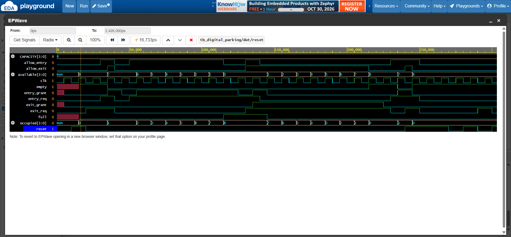
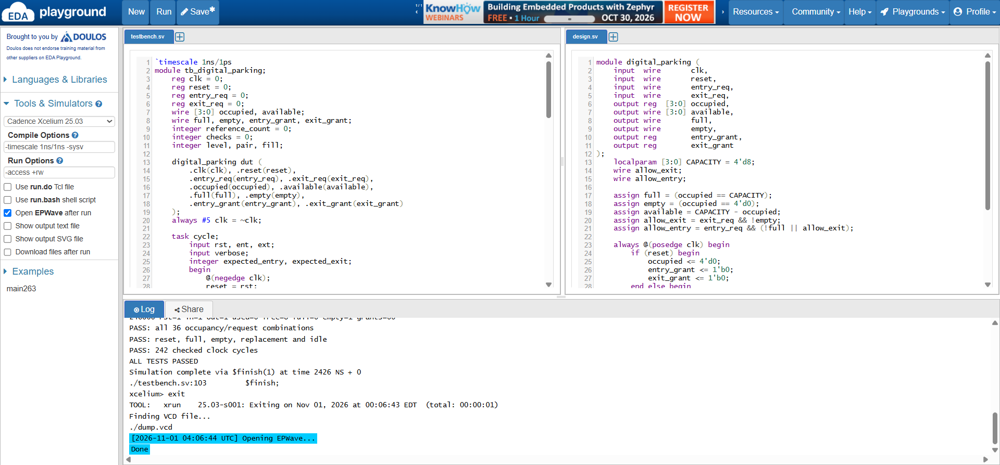

# Digital parking system

A Verilog controller for an eight-space parking area. It counts vehicles entering and leaving, shows how many spaces are available, and indicates when the area is full or empty.

The controller reads `entry_req` and `exit_req` at each rising clock edge. An accepted entry increases `occupied` by one, and an accepted exit decreases it by one. `available` is eight minus `occupied`. Reset clears the count and both request grants.

When all eight spaces are occupied, an entry is accepted if a vehicle leaves in the same cycle. With both requests high, the count stays unchanged as one vehicle replaces another. At empty, only the entry is accepted and the count becomes one. An exit request by itself at empty leaves the count at zero. Each request represents one vehicle event in that clock cycle.

The waveform shows the parking area filling from zero to eight vehicles. The count stays at eight during an extra entry request and a simultaneous entry and exit, then falls to zero as vehicles leave. The full and empty indicators follow the count.

*The EPWave timeline is in ps, so 115000 is 115 ns. The count buses use decimal display.*

At full, the extra entry is rejected. During the simultaneous entry and exit, both grants are high and the count remains eight. After the last vehicle leaves, another exit request is rejected. The simulation log shows all 242 checked clock cycles passing, including all 36 combinations of occupancy level and entry/exit requests.

To run the project on EDA Playground, copy in the [design](rtl/digital_parking.v) and [testbench](tb/tb_digital_parking.v), with `tb_digital_parking` as the top module. Use the SystemVerilog design/testbench editors and select Cadence Xcelium 25.03. Set Compile Options to `-timescale 1ns/1ns -sysv` and Run Options to `-access +rw`. Tick Open EPWave after run, then click Run. In EPWave, click Get Signals, open `tb_digital_parking`, and select the count, request, grant and status signals.
